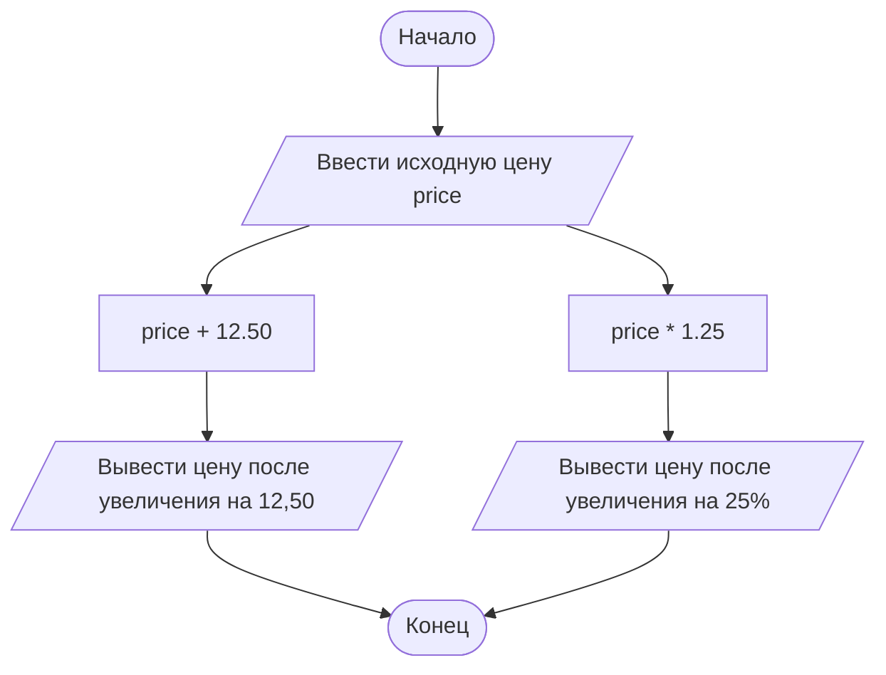

# Домашнее задание к лабораторной работе № 3

## 1. Условие задачи

Переменная типа `double` с именем `price` содержит цену товара. Написать операторы для увеличения цены:

1. на 12,50;
2. на 25%.

## 2. Алгоритм и блок-схема

1. Ввести исходную цену товара.
2. Прибавить к цене значение `12.50`, чтобы увеличить её на 12,50.
3. Умножить исходную цену на `1.25`, чтобы увеличить её на 25%.
4. Вывести оба результата.



## 3. Реализация программы

Увеличение цены на 12,50:

```c
price = price + 12.50;
```

Увеличение цены на 25%:

```c
price = price * 1.25;
```

Полный пример программы на C:

```c
#include <stdio.h>

int main() {
    double price;
    double price_plus;
    double price_percent;

    printf("Введите исходную цену товара: ");
    if (scanf("%lf", &price) != 1) {
        printf("Ошибка ввода.\n");
        return 1;
    }

    price_plus = price + 12.50;
    price_percent = price * 1.25;

    printf("Цена после увеличения на 12.50: %.2f\n", price_plus);
    printf("Цена после увеличения на 25%%: %.2f\n", price_percent);

    return 0;
}
```

## 4. Результаты работы программы

Для проверки возьмём исходную цену товара `100.00`.

Ввод:
```text
100
```

Вывод:
```text
Введите исходную цену товара: 100
Цена после увеличения на 12.50: 112.50
Цена после увеличения на 25%: 125.00
```

## 5. Информация о разработчике

**Хром А. И.**, группа **бИД-261**.
